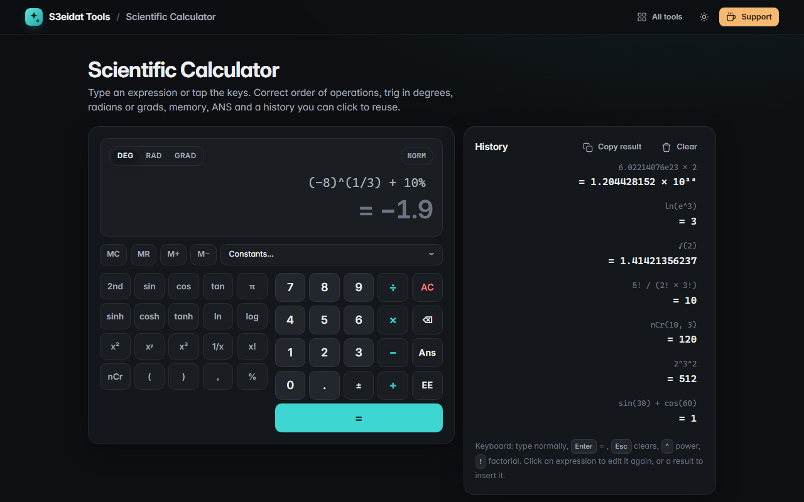

# Scientific Calculator

> A full scientific calculator with history, memory and keyboard support. Free, private, and it runs entirely in your browser.

### ▶ [Open Scientific Calculator](https://s3eidat.github.io/sci-calc/)



## Features

- **Correct order of operations** from its own parser (no `eval`): `2^3^2 = 512`, `−2^2 = −4`, `2(3+4) = 14`, `3!^2 = 36`
- **Degrees, radians or grads**; trig is exact at right angles (`sin 90° = 1`, `cos 90° = 0`, `tan 90°` is undefined)
- `sin cos tan` and inverses, `sinh cosh tanh` and inverses (**2nd** key), `ln log eˣ 10ˣ`, `x² x³ xʸ √ ∛ ʸ√x`, `1/x`, `|x|`, `mod`
- **Factorial** (non-integers via the gamma function), **nCr** and **nPr**, **%**
- **Ans** and memory (**MC MR M+ M−**), π, e and a list of physical **constants** (c, g, G, h, k, Nₐ, e, mₑ, R, φ)
- **Scientific notation** input (`EE`, `6.02e23`) and display (NORM or SCI)
- **History**: click an expression to edit it again or a result to insert it; copy the last result
- Type with the keyboard: `Enter` = , `Esc` clears; your history, memory and settings stay on this device

## Privacy

Nothing leaves your device. There is no server, no account, no analytics.
The page ships with a strict Content-Security-Policy (`connect-src 'self'`), so the browser
itself blocks any attempt to send data anywhere.

## Run it yourself

It's plain HTML, CSS and JavaScript with no build step:

```bash
git clone https://github.com/s3eidat/sci-calc
cd sci-calc
python -m http.server 8000
```

Then open http://localhost:8000.

## Support

If this saved you time, **[buy me a coffee ☕](https://s3eidat.github.io/coffee/)**. It keeps every tool free.

---

Part of **[S3eidat Tools](https://s3eidat.github.io/)**: 100+ free, private tools that run in your browser. MIT licensed.
